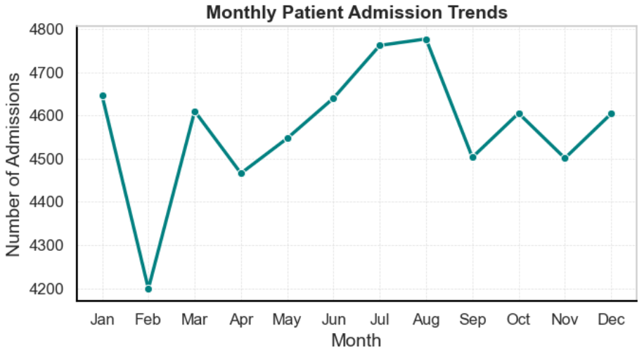
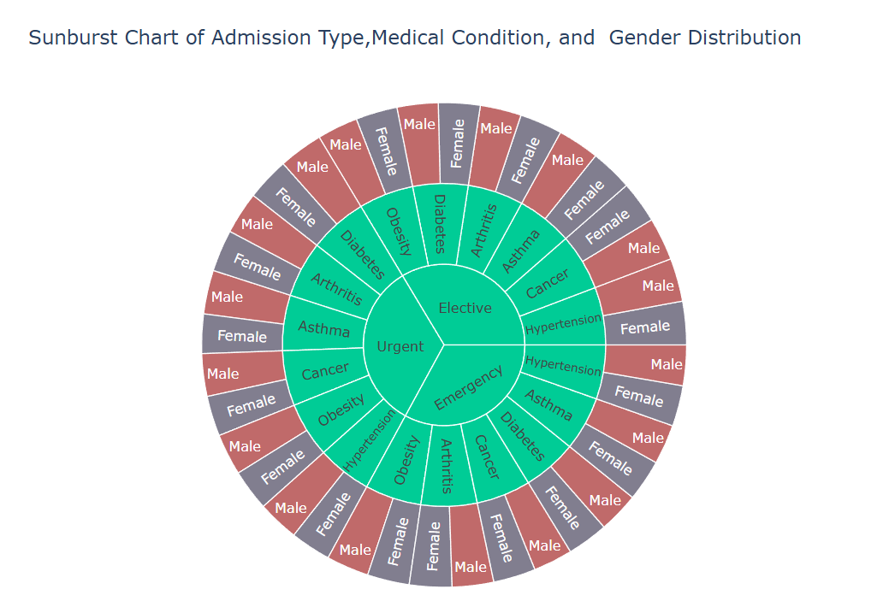
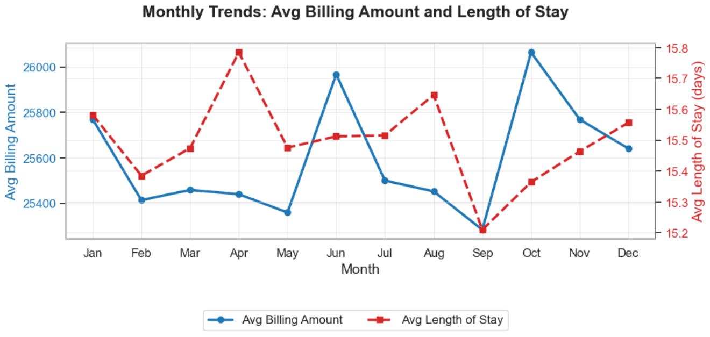
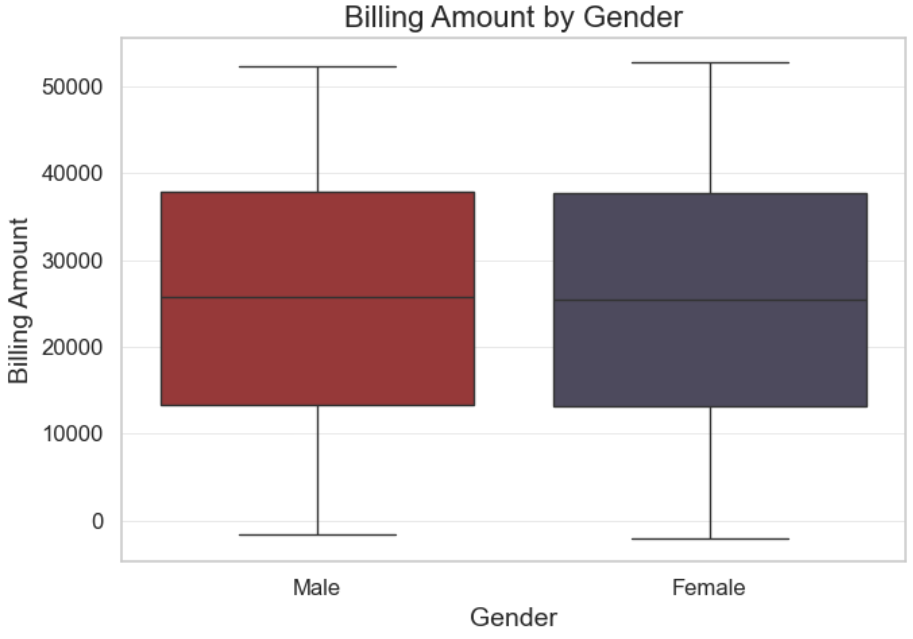
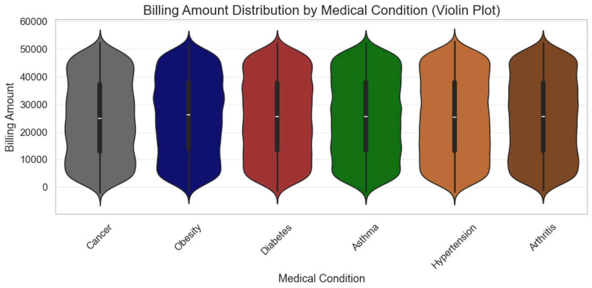
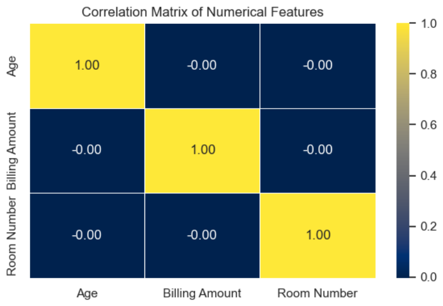
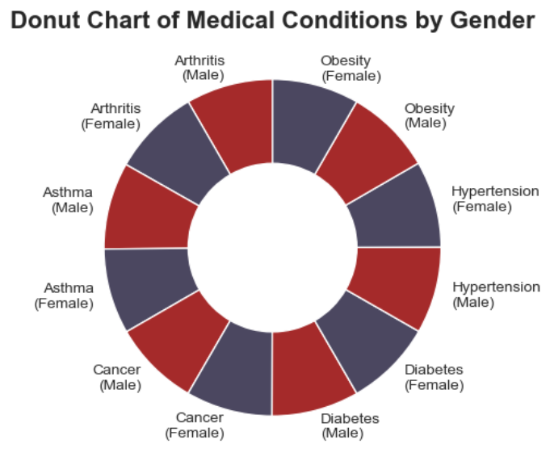

# Healthcare Data Visualization Using Python

**Exploratory Data Analysis | Healthcare Analytics | Data Visualization**

A Python-based exploratory analysis of healthcare records, investigating patient demographics, hospital admissions, medical conditions, billing amounts, and length of stay. The project illustrates how data cleaning and visual storytelling can help identify patterns relevant to healthcare operations and resource planning.

## Project objectives

- Inspect and prepare healthcare records for analysis.
- Explore patient demographics and medical conditions.
- Compare billing distributions across genders and medical conditions.
- Examine monthly admission patterns and length-of-stay trends.
- Communicate findings using clear statistical and interactive visualizations.

## Dataset

The original dataset contains **55,500 records and 15 columns**, including age, gender, medical condition, admission and discharge dates, admission type, billing amount, insurance provider, and hospital details. The project poster identifies the source as **Kaggle**; a direct dataset URL will be added here after confirmation.

**Dataset source:** Kaggle — *link to be added*.

> **Data note:** This is a public portfolio analysis of a Kaggle dataset, not a validated clinical study. The dataset's licensing and privacy suitability should be confirmed before publishing the raw CSV.

## Tools and libraries

Python · Jupyter Notebook · pandas · NumPy · SciPy · Matplotlib · Seaborn · Plotly

## Workflow

1. **Inspect data:** Review columns, data types, summary statistics, and missing values.
2. **Clean data:** Standardize text fields, remove duplicate rows, exclude negative billing amounts and invalid lengths of stay, and convert date fields.
3. **Engineer features:** Calculate length of stay from discharge and admission dates; extract admission month and year.
4. **Explore relationships:** Analyze patient demographics, medical conditions, billing distributions, and numerical correlations.
5. **Visualize:** Create line charts, box plots, violin plots, a correlation heatmap, a donut chart, and a Plotly sunburst chart.

## Featured visualizations

### Monthly patient admissions



Admissions vary by month in the aggregated analysis, with the highest observed total in August and the lowest in February. The chart aggregates months across the available years; it does not alone establish a recurring seasonal effect.

### Admission type, medical condition, and gender



A hierarchical Plotly sunburst visualizes the composition of admission types by medical condition and gender.

### Average billing amount and length of stay



This dual-axis chart compares monthly average billing amounts with average hospital length of stay. The project report notes that October has the highest average billing, while April has the longest average stay.

## Additional visualizations

### Billing amount by gender



The male and female billing distributions are broadly similar in the visualized sample.

### Billing amount by medical condition



Violin plots compare the spread of billing amounts for cancer, obesity, diabetes, asthma, hypertension, and arthritis.

### Correlation heatmap



The plotted numerical variables—age, billing amount, and room number—show correlations close to zero in this dataset.

### Medical conditions by gender



A donut chart presents the gender composition across six medical conditions. These descriptive counts should not be interpreted as population disease prevalence.

## Key observations

- The source file has **55,500 rows**; the notebook's descriptive-statistics output shows **54,860 rows** after cleaning.
- The source file contains **534 exact duplicate rows**.
- Monthly admissions and billing averages vary across the observed period.
- Billing distributions are broadly comparable between male and female patients.
- Age, billing amount, and room number show little linear association in the reported correlation matrix.

These findings are **descriptive**, not evidence of causation or validated predictions about clinical outcomes.

## Repository contents

```text
healthcare-data-visualization-python/
├── README.md
├── requirements.txt
├── data/
│   └── healthcare_dataset.csv             # Only if redistribution is permitted
├── notebooks/
│   └── Healthcare_Data_Visualization_Analysis.ipynb
├── visualizations/
│   ├── monthly_patient_admissions.png
│   ├── admission_type_medical_condition_gender.png
│   ├── billing_vs_length_of_stay.png
│   ├── billing_amount_by_gender.png
│   ├── billing_distribution_by_condition.png
│   ├── correlation_heatmap.png
│   └── medical_conditions_by_gender.png
└── reports/
    ├── Data Visualization report.pdf
    └── project_poster.pdf
```

## How to run

1. Clone or download the repository.
2. Install dependencies: `pip install -r requirements.txt`.
3. Place an authorized copy of the dataset at `data/healthcare_dataset.csv`.
4. Open `notebooks/Healthcare_Data_Visualization_Analysis.ipynb` in Jupyter.
5. **Before running**, update the notebook's dataset-loading line to:

   ```python
   df = pd.read_csv("../data/healthcare_dataset.csv")
   ```

6. Run the notebook cells in order. The notebook includes a `!pip install plotly` cell, which can be skipped if dependencies were installed in step 2.

## Reports

- [Full project report](reports/Data%20Visualization%20report.pdf)
- [Project poster](reports/project_poster.pdf)

## Limitations and next steps

The available records have limited clinical outcome and geographical information. Aggregated monthly patterns do not by themselves prove seasonality. Future improvements could include a dashboard, deeper validation of data quality, and more detailed comparisons by admission type and condition.

## Author

**Reginald Didia**  
Healthcare Data Visualization | Python | Exploratory Data Analysis

## Dataset Source

The dataset used in this project was obtained from Kaggle.

**Dataset:** Healthcare Dataset  
**Source:** Kaggle  
**Creator:** prasad22

**Dataset URL:** https://www.kaggle.com/datasets/prasad22/healthcare-dataset

The dataset contains information about patient demographics, medical conditions, hospital admissions, billing amounts, insurance providers, and hospital stays.

The original dataset is credited to its creator.
